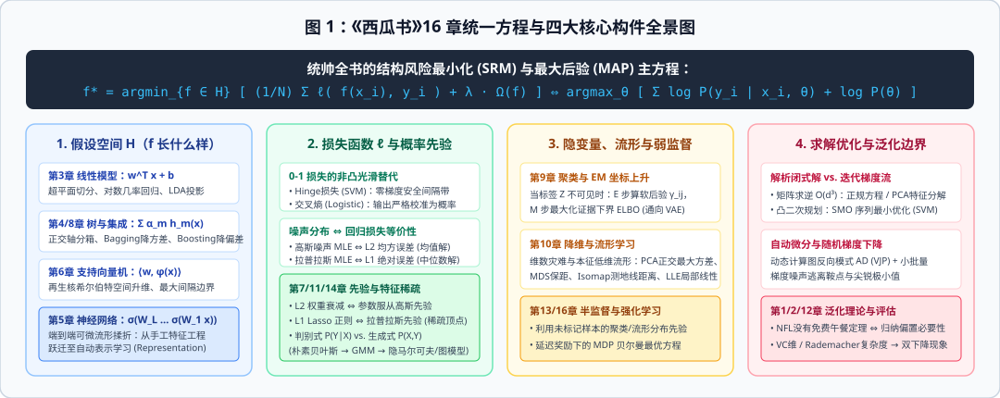
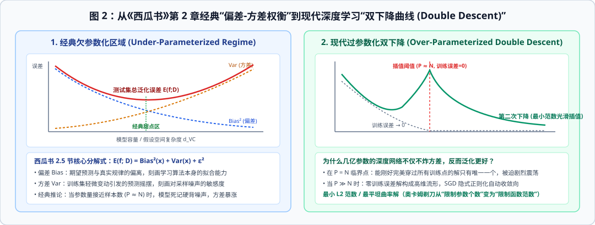
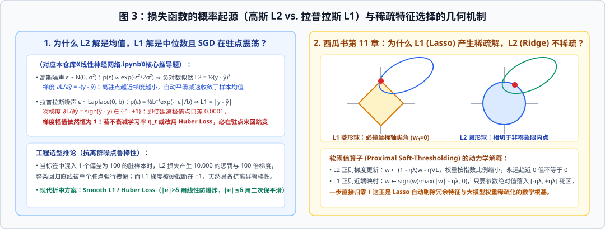
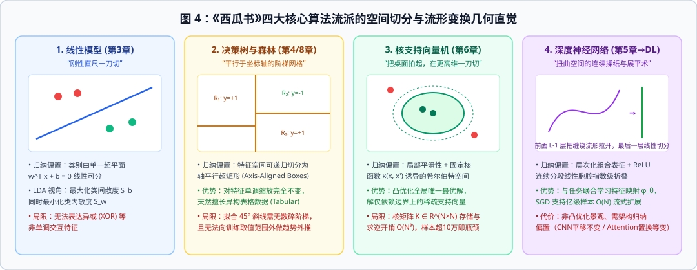
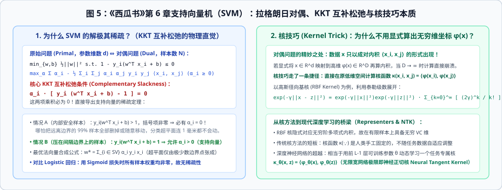
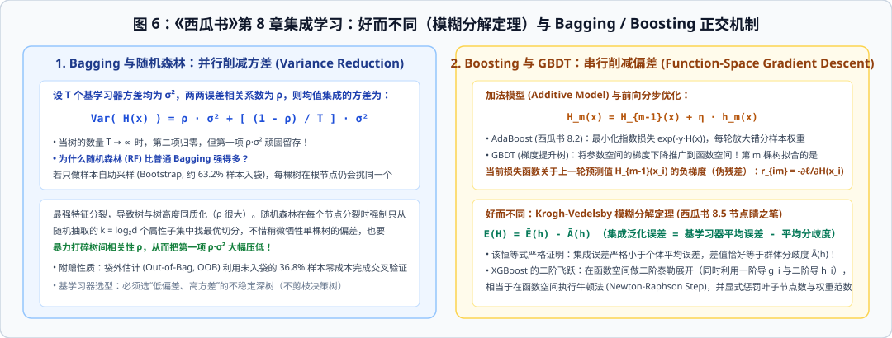
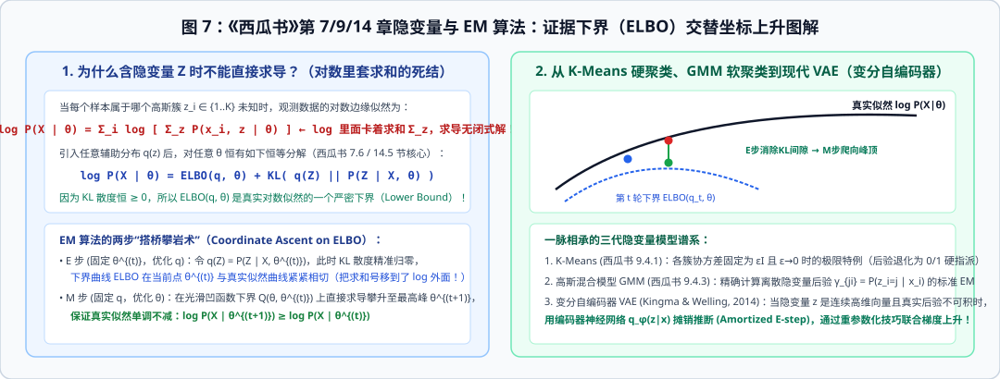
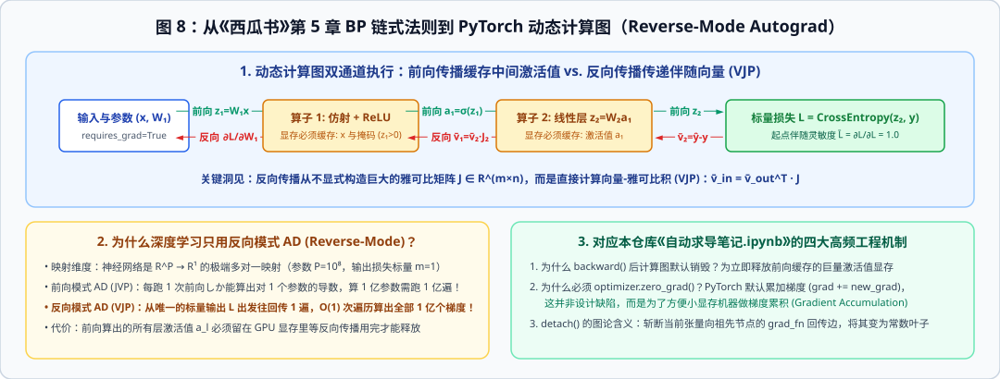

# 西瓜书 × 深度学习：绘本式数学直觉与 Jupyter 交互案例笔记

这是一份将周志华教授《机器学习》（俗称**《西瓜书》**）第 1 至 16 章核心理论与**现代深度学习（PyTorch / 李沐《动手学深度学习》）**彻底打通的**绘本式图文笔记与交互实验库**。

很多人第一次翻开《西瓜书》时，往往在第 1 页还在兴致勃勃地看“色泽青绿、根蒂蜷缩、敲声浊响是不是好瓜”，翻到第 3 页就被满篇的集合符号、拉格朗日乘子、海森矩阵和变分下界砸晕了。其实，**机器学习的每一个冰冷公式背后，都藏着一个极其鲜活的物理场景、一场几何空间里的刀法对决，或者一次真实工程里的翻车事故。**

为了把这些藏在公式背后的直觉彻底画出来、跑起来，本仓库采用**“绘本故事 + 原理剖析长图（8 张原创 SVG） + 真实代码跑测三联图（6 张矢量实验图） + 12 个带预渲染输出的 Jupyter Notebook（`.ipynb`）”**的四合一形式：你既可以直接在当前页面像翻阅连环画一样顺着夏日瓜摊的故事读完全书脉络，也可以随时点击任意一节的 `.ipynb` 链接，在 GitHub 网页端或本地 Jupyter 中查看完整的代码实现与内嵌彩色图表。



---

## 零、全书一张纸总纲：原来整本《西瓜书》都在解同一个方程！

在进入六个绘本故事之前，我们先退后一步，俯瞰上图中间那个绿色大框。无论是《西瓜书》前 10 章的经典算法，还是现代百亿参数的神经网络，剥去各自华丽的外衣后，**它们全都在求解同一个“结构风险最小化（SRM）”主方程**；而只要给它套上一层负对数（$-\log$），它就与贝叶斯学派的**“最大后验概率估计（MAP）”**严丝合缝地等价：

$$\underbrace{\arg\min_{f \in \mathcal{H}} \; \frac{1}{N}\sum_{i=1}^{N} \ell\big(f(\boldsymbol{x}_i), y_i\big) + \lambda \, \Omega(f)}_{\text{频率派视角：经验风险（拟合训练数据）} + \text{正则化惩罚（控制模型复杂度）}} \quad \Longleftrightarrow \quad \underbrace{\arg\max_{\boldsymbol{\theta}} \; \sum_{i=1}^{N} \log P(y_i \mid \boldsymbol{x}_i; \boldsymbol{\theta}) + \log P(\boldsymbol{\theta})}_{\text{贝叶斯派视角：对数似然（数据似然度）} + \text{对数先验（奥卡姆剃刀先验）}}$$

沿着这个大一统方程，全书 16 章自然拆解为四个问题：
1. **去哪儿找函数？（假设空间 $\mathcal{H}$）**：是用一条直线去切（第 3 章线性模型），用横平竖直的盒子去装（第 4 章决策树），拍到无穷维空间再切（第 6 章核函数 SVM），还是像揉面团一样把扭曲空间折叠拉平（第 5 章神经网络）？
2. **犯了错怎么罚？（损失函数 $\ell$ 与先验 $\Omega$）**：为什么假设高斯噪声就导出平方误差 $L_2$，假设拉普拉斯噪声就导出绝对误差 $L_1$？为什么 $L_2$ 正则化对应圆球、而 $L_1$ 正则化对应带尖角的菱形？
3. **怎么一步步走到谷底？（优化算法 $\mathcal{O}$）**：从一阶小批量随机梯度下降（SGD）、二阶牛顿法（XGBoost），到处理无标签隐变量的证据下界坐标上升（EM 算法），再到深度学习的反向模式自动求导（Autograd）。
4. **怎么保证出了门不翻车？（泛化评估 $\mathcal{G}$）**：偏差与方差到底在博弈什么？为什么现代神经网络参数比样本多几百倍，反而跳出了经典过拟合陷阱？

---

## 一、本仓库 12 节 Jupyter Notebook 交互课程总览

本仓库包含两大系列的 `.ipynb` 交互式笔记本（**所有新案例笔记本均已预执行完毕，点开即可直接在 GitHub 看到渲染好的彩色图表与实验成绩单**）：

### 系列 A：《西瓜书 × 深度学习》六大绘本级故事案例课（[`notebooks/`](./notebooks/)）

| 绘本回次 | 交互式 Jupyter 案例课（点击直达） | 对应《西瓜书》核心章节 | 故事主角与亲手验证的反直觉现象 |
| :--- | :--- | :--- | :--- |
| **第一回** | [`01_夏日挑瓜记_偏差方差与双下降曲线.ipynb`](./notebooks/01_夏日挑瓜记_偏差方差与双下降曲线.ipynb) | 第 1 章 绪论<br>第 2 章 模型评估与选择 | 一根筋阿呆（1阶欠拟合）vs 死记硬背阿强（14阶过拟合）vs 跨越 $P=N$ 插值爆炸墙后的**现代过参数化双下降奇迹** |
| **第二回** | [`02_天价金瓜搅局记_L1与L2损失及Lasso稀疏几何.ipynb`](./notebooks/02_天价金瓜搅局记_L1与L2损失及Lasso稀疏几何.ipynb) | 第 3 章 线性模型<br>第 7 章 极大似然<br>第 11 章 稀疏学习 | 2 个网红天价金瓜如何把 $L_2$ 直线拽歪 $25^\circ$？为什么 $L_1$ 刀枪不入却在谷底反复横跳？**$L_1$ 菱形尖角如何把 8 个噪音噱头特征精准砍成 0？** |
| **第三回** | [`03_切豆腐与揉面团_决策树与神经网络流形对决.ipynb`](./notebooks/03_切豆腐与揉面团_决策树与神经网络流形对决.ipynb) | 第 4 章 决策树<br>第 5 章 神经网络 | 当好瓜与坏瓜拧成太极双月牙：看切豆腐刀客（CART 树）如何苦苦切出直角锯齿阶梯，而揉面团魔术师（ReLU 网络）如何在隐藏层**把弯曲月牙直接掰成一条直线可分**！ |
| **第四回** | [`04_撑起楚河汉界的少数派_SVM对偶与核技巧案例.ipynb`](./notebooks/04_撑起楚河汉界的少数派_SVM对偶与核技巧案例.ipynb) | 第 6 章 支持向量机 | **亲手删掉大后方 94% 的瓜，重新训练后超平面竟然连 0.001 毫米都不动！** 外加一掌把二维同心圆死局拍上三维 $z=x_1^2+x_2^2$ 用水平面一刀切开 |
| **第五回** | [`05_三个臭皮匠的数学秘密_随机森林与GBDT残差接力.ipynb`](./notebooks/05_三个臭皮匠的数学秘密_随机森林与GBDT残差接力.ipynb) | 第 8 章 集成学习 | 为什么 50 个克隆人投票毫无意义？看 30 棵满身锯齿的深树平均后如何瞬间丝滑（降方差），以及 GBDT 的 20 棵浅树如何**专门盯着上一轮的“错题本残差”接力补漏**（降偏差） |
| **第六回** | [`06_盲人摸象与回声追责_EM软聚类与手搓Autograd引擎.ipynb`](./notebooks/06_盲人摸象与回声追责_EM软聚类与手搓Autograd引擎.ipynb) | 第 5 章 5.3 BP算法<br>第 7/9/14 章 EM与聚类 | 撕掉标签的两车倾斜椭圆瓜堆：看 K-Means 球盲如何拦腰斩错，EM-GMM 如何搭起 ELBO 拱桥把准确率拉到 `97.7%`；最后**用 35 行纯 Python 从零手搓一个 PyTorch `Autograd` 引擎**！ |

### 系列 B：PyTorch 与数学基石手写笔记（仓库根目录原生系列）

| 笔记名称（点击直达） | 核心内容与推导亮点 | 联动绘本回次 |
| :--- | :--- | :--- |
| [`数据处理笔记.ipynb`](./数据处理笔记.ipynb) | PyTorch 张量内存布局、广播机制（Broadcasting）、原地操作显存控制与缺失值插补 | 第一回 |
| [`线代笔记.ipynb`](./线代笔记.ipynb) | 矩阵乘法几何变换、点积与正交投影、Frobenius 范数与奇异值/特征谱分解 | 第四回 |
| [`积分导数笔记.ipynb`](./积分导数笔记.ipynb) | 标量对向量求导法则、方向导数与梯度几何指向、海森矩阵（Hessian）与二阶泰勒展开 | 第五回 |
| [`自动求导笔记.ipynb`](./自动求导笔记.ipynb) | PyTorch 动态计算图构建、非标量 `backward` 向量-雅可比积（VJP）、`detach()` 截断与梯度清零机制 | 第六回 |
| [`线性神经网络.ipynb`](./线性神经网络.ipynb) | 最小二乘闭式解 $\boldsymbol{w}^*=(\boldsymbol{X}^\top\boldsymbol{X})^{-1}\boldsymbol{X}^\top\boldsymbol{y}$、高斯噪声 $\iff L_2$ 均值解、**拉普拉斯噪声 $\iff L_1$ 驻点次梯度震荡推导** | 第二回 |
| [`线性回归的实现.ipynb`](./线性回归的实现.ipynb) | 不调 `torch.nn` 从零手写合成数据集、小批量随机采样迭代器 `data_iter` 与 SGD 完整训练闭环 | 第一回、第二回 |

---

## 第一回：夏日瓜摊挑瓜记（从奥卡姆剃刀、偏差-方差分解到现代双下降之谜）

> **配套交互笔记本**：[`notebooks/01_夏日挑瓜记_偏差方差与双下降曲线.ipynb`](./notebooks/01_夏日挑瓜记_偏差方差与双下降曲线.ipynb) | **联动笔记**：[`线性回归的实现.ipynb`](./线性回归的实现.ipynb)

### 1.1 绘本故事：瓜摊上的三个学徒，谁才是真高手？

盛夏午后，老瓜农在摊位上摆了 **15 个已经切开测过糖度的西瓜**（训练集样本数 $N=15$）。他用小木槌挨个敲击瓜肚，记录下每个瓜的声学频率 $x_i$ 和甜度偏离值 $y_i$。因为测糖仪偶尔手抖，每个瓜的实测甜度里都混入了一点高斯随机测量误差 $\varepsilon \sim \mathcal{N}(0, 0.22^2)$。

老瓜农把账本交给三个学徒，让他们各自总结出一套“听声辨甜度”的预测公式 $f(x)$：

* **大徒弟阿呆（1 阶线性模型）**：是个死脑筋。不管敲声怎么变化，他坚持认为甜度和敲声频率永远成正比，拿着一把直尺在纸上画了一条笔直的斜线 $f(x) = w_1 x + w_0$。结果连最基本的“脆响最甜、太沉闷或太尖锐都不甜”的拱形规律都没看出来。在机器学习里，阿呆犯的是**欠拟合（Underfitting）**，病根在于模型容量太小，**偏差（Bias）太高**。
* **二徒弟阿强（14 阶多项式模型）**：是个死记硬背的应试状元。他拍着胸脯说：“区区 15 个点，我用最高 14 次方的多项式 $f(x) = \sum_{k=0}^{14} w_k x^k$，一定能解出一条分毫不差穿过每一个点的曲线！”他在草稿纸上把这 15 个瓜的训练误差算到了 `0.0000`。可第二天新拉来一车瓜，阿强的公式在两个旧瓜之间的空隙里像心电图一样剧烈上下抽搐（数值分析中的**龙格现象**），算出来的甜度甚至飙到了离谱的负数！阿强犯的是**过拟合（Overfitting）**，病根在于把测糖仪的手抖噪声也当成了真理背了下来，导致**方差（Variance）爆炸**。
* **老瓜农自己（4 阶平滑曲线）**：谨遵《西瓜书》1.4 节的**奥卡姆剃刀原则（Occam's Razor）**，允许个别带噪声的瓜稍微偏离曲线一点点，只顺着大趋势画出一道温和的 4 阶弧线。虽然在今天这 15 个瓜上有 `0.03` 的微小误差，但在明天的新瓜车上稳居第一。



### 1.2 数学解剖室：偏差、方差与颠覆常识的“双下降曲线”

在《西瓜书》2.5 节中，周志华老师给出了诊断一切模型的黄金标尺。假设我们在 60 个平行宇宙里各自进货 15 个瓜（训练集 $D$），学徒在每个宇宙都算出一套公式 $f(x; D)$。那么对于新瓜 $x$，期望泛化误差严格等于三项之和：

$$E(f; D) = \underbrace{\big( \mathbb{E}_D[f(x; D)] - f^*(x) \big)^2}_{\text{Bias}^2(x)\text{：平行宇宙平均预测与天道真值的偏离（瞄得准不准）}} + \underbrace{\mathbb{E}_D\Big[ \big( f(x; D) - \mathbb{E}_D[f(x; D)] \big)^2 \Big]}_{\text{Var}(x)\text{：换一批训练瓜公式抖动有多剧烈（手稳不稳）}} + \underbrace{\sigma_\varepsilon^2}_{\text{测量手抖噪声下界}}$$

到这里还是经典教科书的内容。但当你在学深度学习时，一定会冒出一个巨大的疑问：
> **“既然阿强用 15 个参数去拟合 15 个瓜都会方差爆炸，为什么现代深度神经网络动辄几千万、几百亿参数（参数量 $P$ 远大于样本数 $N$），不仅没有背书崩溃，反而泛化能力极强？！”**

请看上方原理图右侧与下方真实代码跑出的第三张图（**现代双下降曲线 Double Descent**）：
1. **为什么刚好在 $P = N$（插值阈值）处死得最惨？** 当参数量 $P=15$ 恰好等于样本数 $N=15$ 时，方程组 $\boldsymbol{\Phi}\boldsymbol{w} = \boldsymbol{y}$ 有且仅有**唯一解** $\boldsymbol{w} = \boldsymbol{\Phi}^{-1}\boldsymbol{y}$。此时模型没有任何挑选的余地，为了强行扭曲身体穿过那几个手抖噪声点，系数向量 $\boldsymbol{w}$ 的范数被迫暴涨几十倍，稍微来一点测试扰动就原地爆炸！
2. **为什么跨过 $P \gg N$ 后测试误差竟然第二次下降？** 当参数量继续增加到 $P = 110 \gg N = 15$ 时，能够把 15 个训练瓜全部拟合到 0 误差的解不再是唯一的，而是构成了高维空间里的一个无穷维超平面！在这个超平面里，既有像阿强那样上蹿下跳的疯子曲线，也有非常平缓温和的曲线。**而无论是用伪逆求解还是用随机梯度下降（SGD）从零初始化开始迭代，优化算法都会在无穷多个 0 误差解中，自动挑出权重 $\ell_2$ 范数 $\|\boldsymbol{w}\|_2$ 最小的那一个解！** 最小的权重范数抑制了高频震荡，让曲线重新变得丝滑平整。

### 1.3 真实代码跑测与成绩单


| 挑瓜选手 / 模型容量 | 平行宇宙偏差平方 $\text{Bias}^2$ | 平行宇宙方差 $\text{Variance}$ | 新瓜测试总误差 $\text{MSE}$ | 绘本诊断结论 |
| :--- | :---: | :---: | :---: | :--- |
| **大徒弟阿呆（1 阶直线，$P=2$）** | `0.2198` | `0.0079` | `0.2761` | 手很稳但眼睛太死板（高偏差欠拟合） |
| **老瓜农（4 阶多项式，$P=5$）** | `0.0080` | `0.0235` | **`0.0799`** | **经典 U 型曲线黄金甜点区** |
| **二徒弟阿强（12 阶多项式，$P=13\approx N$）** | `0.0110` | **`0.5944`** | `0.6538` | 逼近 $P=N$ 插值爆炸墙，方差飙升 25 倍 |
| **过参数化模型（最小范数插值，$P=110 \gg N$）** | 训练误差 `0.0000` | 最小范数隐式抑制 | **`0.1685`** | **跨过插值墙后测试误差大幅回落（双下降）！** |

---

## 第二回：天价金瓜搅局记（高斯 $L_2$、拉普拉斯 $L_1$ 次梯度震荡与 Lasso 菱形尖角的稀疏魔法）

> **配套交互笔记本**：[`notebooks/02_天价金瓜搅局记_L1与L2损失及Lasso稀疏几何.ipynb`](./notebooks/02_天价金瓜搅局记_L1与L2损失及Lasso稀疏几何.ipynb) | **深度联动**：[`线性神经网络.ipynb`](./线性神经网络.ipynb)

### 2.1 绘本故事：两个网红“天价金瓜”如何拉垮整套估值系统？

老瓜农给摊位上的 **28 个普通西瓜**按重量 $x$（公斤）标售价 $y$（元），平时遵循着稳定的物价规律：每公斤 3 元，外加 5 元基础礼盒费，即 $y = 3x + 5$。

谁知这天来了个网红带货主播，把角落里两个重约 9 公斤的普通瓜贴上金箔，炒作成“开光天价金瓜”，分别卖出了 **68 元**和 **75 元**的天价！

学徒阿强把这 30 个瓜的账本输入电脑，直接调用了《西瓜书》第 3 章式 (3.4) 的**最小二乘法（均方误差 $L_2$ Loss）**。结果算出来的定价直线斜率当场从真实的 `3.00` 飙升到了 **`5.86`**！第二天街坊大妈来买个 6 公斤的普通瓜，系统张口就要 35 块钱，差点把瓜摊招牌都砸了。



### 2.2 数学解剖室：为什么 $L_2$ 怕刺客、$L_1$ 会震荡、Lasso 能砍特征？

这三个困扰无数初学者的问题，在我们在 [`线性神经网络.ipynb`](./线性神经网络.ipynb) 的推导与上方图 3 中得到了彻底的统一：

1. **为什么均方误差 $L_2$ 见到离群刺客就下跪？**
   因为最小化平方误差 $\sum (y_i - \hat{y}_i)^2$ 在概率上等价于假设误差服从**高斯分布 $\mathcal{N}(0, \sigma^2)$**。高斯分布的尾巴以 $\exp(-r^2)$ 的速度极速衰减，它打心底里认为“绝不可能出现偏差 40 块钱的瓜”！一旦真出现了偏差 $r=40$ 的天价金瓜，平方损失算出的误差是 $40^2 = 1600$，对直线产生的**梯度拉力 $\frac{\partial (r^2/2)}{\partial \hat{y}} = r = 40$**，相当于 40 个正常瓜同时扯着嗓子往天上拽！因此，在常数预测模型下，$L_2$ 的最优解是**样本均值（Mean）**，极易被极端富豪或离群噪点劫持。
2. **为什么绝对值误差 $L_1$ 刀枪不入，却在谷底来回“蹦迪”震荡？（验证 [`线性神经网络.ipynb`](./线性神经网络.ipynb) 第 5 节笔记）**
   如果把噪声假设换成厚尾的**拉普拉斯分布 $p(\varepsilon) = \frac{1}{2b}\exp(-|\varepsilon|/b)$**，取负对数后得到的恰好是**绝对值损失 $L_1 = |y_i - \hat{y}_i|$**！看它的导数（次梯度）：
   $$\frac{\partial |r|}{\partial r} = \text{sign}(r) = \begin{cases} +1, & r > 0 \\ -1, & r < 0 \\ [-1, 1], & r = 0 \end{cases}$$
   这意味着：哪怕那个网红金瓜贵到 100 万块钱，它对直线的拉力**封顶也只有 $+1$**，跟旁边一个普通瓜的投票权完全相等！所以 $L_1$ 的最优解对应**样本中位数（Median）**，天然无视离群刺客。
   **但凡事皆有代价**：正因为 $L_1$ 的导数在 $r=0$ 两侧是 $+1$ 和 $-1$ 的悬崖跳变（不像 $L_2$ 越靠近谷底导数越小），如果你用固定学习率 $\eta$ 做梯度下降，一步迈过去是 $-\eta$，下一步立刻变成 $+\eta$，参数永远在最优解左右两侧反复横跳（见下方实验图中图）！工程上要想兼得 $L_1$ 的抗噪与 $L_2$ 的谷底平稳，只需在 $|r| < \delta$ 的谷底换上抛物线、在 $|r| \ge \delta$ 的两侧保留直线，这就是大名鼎鼎的 **Huber Loss（Smooth $L_1$）**。
3. **为什么只有 $L_1$ 正则化（Lasso）能把没用的噱头特征精准砍成 `0`？**
   假设瓜贩子除了给 `糖度`、`日照` 两个真特征外，还乱七八糟塞了 `瓜农星座`、`摘瓜时辰`、`货车车牌尾号` 等 **8 个纯随机噪音特征**。
   * **$L_2$ 岭回归（Ridge）**限制参数在圆球 $w_1^2 + w_2^2 \le C$ 内：圆球表面处处光滑无棱角，损失函数的椭圆等高线扩展过来时，切点几乎不可能恰好落在坐标轴上，导致 8 个噪音特征全都留着非零的小尾巴。
   * **$L_1$ 稀疏回归（Lasso，《西瓜书》11.4 节）**限制参数在菱形多面体 $|w_1| + |w_2| \le C$ 内：**菱形的四个尖角正好死死戳在坐标轴（$w_j = 0$）上！** 椭圆等高线往外一扩，十有八九直接撞在坐标轴的尖角顶点上。从解析式看，Lasso 的近端软阈值算子 $w_j^* = \text{sign}(\rho_j)\max\big(|\rho_j| - \frac{\lambda}{2}, 0\big)$ 直接把所有相关性不够强的噪音特征全部剃成了精确的 `0.0000`！

### 2.3 真实代码跑测与成绩单


| 实验场景与对比项 | 均方误差 / $L_2$ 派系（高斯假设） | 绝对误差 / $L_1$ 派系（拉普拉斯假设） | 平滑拼接 Huber 派系 |
| :--- | :---: | :---: | :---: |
| **场景 A：混入 2 个天价金瓜后的回归斜率（真实斜率 `3.00`）** | 飙升至 **`5.86`**（严重失真） | 稳守 **`3.21`**（免疫刺客） | 稳守 **`3.32`**（免疫刺客） |
| **场景 B：固定步长 $\eta=0.35$ 迭代 18 步后的驻点残差** | 收敛至 `0.0016`（丝滑着陆） | 在 **`+0.30` 与 `-0.05` 间永久震荡** | 丝滑着陆且远端抗噪 |
| **场景 C：10 维特征中 8 个纯噪音特征被精确归零的个数** | `0 / 8`（全残留小尾巴） | **`8 / 8`（8 个假特征全部精准砍为 0！）** | 适用于损失函数层 |

---

## 第三回：切豆腐的刀客 vs. 揉面团的魔术师（决策树正交切分与神经网络流形展开）

> **配套交互笔记本**：[`notebooks/03_切豆腐与揉面团_决策树与神经网络流形对决.ipynb`](./notebooks/03_切豆腐与揉面团_决策树与神经网络流形对决.ipynb)

### 3.1 绘本故事：当好瓜与坏瓜拧成了“太极双月牙”

如果瓜田里的好瓜和坏瓜不是规规矩矩按“糖度 $> 10$”就能分开的，而是像太极图的阴阳双鱼一样**互相环抱、旋转交错**（非线性流形），《西瓜书》第 4 章的**决策树**和第 5 章的**神经网络**会怎么应对？



* **切豆腐的刀客（决策树，第 4 章）**：无论是用信息增益（ID3）、增益率（C4.5）还是基尼指数（CART），决策树每个节点的判断永远是单变量阈值比较：$\text{“特征 } x_d \le t \text{ 吗？”}$。在几何上，这意味着**刀客手里的菜刀被死死焊在了坐标轴上，每一刀只能横着切（垂直于 $x_2$ 轴）或竖着切（垂直于 $x_1$ 轴）**！遇到弯曲的月牙或 $45^\circ$ 斜线，刀客没法斜着下刀，只能横一刀、竖一刀、再横一刀，在斜坡上切出几十个细碎的**锯齿状俄罗斯方块阶梯**来勉强逼近曲线。
* **揉面团的魔术师（多层神经网络，第 5 章）**：神经网络根本不在原空间里切锯齿。它的隐藏层 $\boldsymbol{h} = \text{ReLU}(\boldsymbol{W}_1\boldsymbol{x} + \boldsymbol{b}_1)$ 像一双魔术手：矩阵 $\boldsymbol{W}_1$ 先把整块二维面团旋转拉伸，激活函数 $\text{ReLU}$ 再沿着多条折痕把面团对折。**经过一层折叠后，原本在原空间里死死咬合的红蓝双月牙，在隐藏层空间 $\boldsymbol{h}$ 里竟然被直接拉开成了左右分明的两团点云！** 最后输出层只需轻轻画一条直线 $\boldsymbol{w}_{\text{out}}^\top \boldsymbol{h} + b = 0$，瞬间完成丝滑切割！

### 3.2 真实代码跑测：亲眼看看魔术师后台是怎么“把月牙掰直”的！

我们在 [`03_切豆腐与揉面团_决策树与神经网络流形对决.ipynb`](./notebooks/03_切豆腐与揉面团_决策树与神经网络流形对决.ipynb) 中不调任何第三方黑盒库，纯手写了一个 **CART 基尼指数决策树** 和一个 **带二维特征瓶颈层的神经网络**，并把神经网络倒数第二层隐藏神经元看到的世界直接画在了最右侧（请重点看下图右三）：


看懂上面第三张小图，你就彻底顿悟了《西瓜书》第 5 章与整个**深度学习（Representation Learning，表征学习）**的灵魂：**深度神经网络的前 $L-1$ 层根本不是分类器，它们是一个可学习的“空间坐标揉面机”，唯一的目标就是把原空间里犬牙交错的非线性流形，揉捏、展开成顶层线性分类器能够一刀切开的线性可分空间！**


---

## 第四回：撑起楚河汉界的少数派（SVM 拉格朗日对偶、KKT 稀疏性与三维升维核魔法）

> **配套交互笔记本**：[`notebooks/04_撑起楚河汉界的少数派_SVM对偶与核技巧案例.ipynb`](./notebooks/04_撑起楚河汉界的少数派_SVM对偶与核技巧案例.ipynb) | **联动笔记**：[`线代笔记.ipynb`](./线代笔记.ipynb)

### 4.1 绘本故事：把大后方 94% 的瓜全扔掉，为什么分界线连 1 毫米都不动？

如果要在两堆好瓜和坏瓜之间画一条分界线（超平面 $\boldsymbol{w}^\top\boldsymbol{x} + b = 0$），第 3 章的对数几率回归（Logistic Regression）采用的是“全民公投制”：摊位上的每一个瓜，哪怕是躲在十万八千里外大后方的安全瓜，都会对分界线产生一份微弱的推力。

而《西瓜书》第 6 章的**支持向量机（SVM）**则是一位极度高冷的军事建筑师：它根本不关心大后方的群众，它只关心怎么在两军最前线的哨兵之间，修出一条**最宽的无人隔离带（最大间隔 $\gamma = \frac{2}{\|\boldsymbol{w}\|_2}$）**。



通过拉格朗日乘子法将原问题转化为对偶问题后，每个瓜 $i$ 都分到了一个话语权系数 $\alpha_i \ge 0$，并且必须严格服从《西瓜书》式 (6.13) 的 **KKT 互补松弛条件（Complementary Slackness）**：

$$\alpha_i \cdot \Big( y_i(\boldsymbol{w}^\top \boldsymbol{x}_i + b) - 1 \Big) = 0$$

请仔细凝视这个简单的乘法等式！两个因子的乘积等于 $0$，在物理上直接导出了一个惊世骇俗的推论：
* **对于躲在隔离带后方的绝大多数安全瓜**：它们满足 $y_i(\boldsymbol{w}^\top \boldsymbol{x}_i + b) > 1$，也就是右边括号严格大于 $0$。为了让乘积等于 $0$，**它们的话语权系数必须严格等于零（$\alpha_i = 0$）！**
* **只有刚好压在隔离带铁丝网边缘上的极少数前线瓜**：它们满足 $y_i(\boldsymbol{w}^\top \boldsymbol{x}_i + b) = 1$（右边括号为 $0$），才被允许拥有非零话语权 **$\alpha_i > 0$**，这几个撑起铁丝网的瓜就叫**支持向量（Support Vectors）**！

既然最终超平面的法向量完全由 $\boldsymbol{w}^* = \sum_{i=1}^{N} \alpha_i y_i \boldsymbol{x}_i$ 合成，那就意味着：**只要不动那两三个压线的支持向量，哪怕你把大后方 94% 的瓜全部删光、扔进垃圾桶，重新训练出来的超平面也绝对连 0.001 毫米都不会动！**

### 4.2 第二幕：当好瓜被坏瓜包了饺子，如何“一掌拍飞”到三维一刀切开？

如果好瓜聚集在圆心，坏瓜像铁桶一样围在外圈（二维同心圆死局），二维平面上任何笔直的刀都切不开。
核技巧（Kernel Trick）微微一笑：别换刀，**换空间**！
我们给每个瓜增加一个高度坐标 $z = x_1^2 + x_2^2$（即到圆心距离的平方），相当于手掌在桌子底下猛拍一掌：
* 靠近圆心的内圈好瓜（$x_1^2+x_2^2$ 很小）留在**三维山谷的谷底**；
* 围在外圈的坏瓜（$x_1^2+x_2^2$ 很大）被这一巴掌直接震飞到了**三维半空中**！

此时，你只需拿一块平平常常的水平玻璃板（三维线性平面 $z = 0.72$）从半空平平插过去，好瓜全在玻璃板下，坏瓜全在玻璃板上！把玻璃板与抛物面的交线投影回二维桌面，恰恰就是一个完美的圆环。而**核函数 $\kappa(\boldsymbol{x}_i, \boldsymbol{x}_j) = \langle \phi(\boldsymbol{x}_i), \phi(\boldsymbol{x}_j) \rangle$** 的精妙之处在于：因为对偶问题里数据只以成对内积形式出现，我们甚至不需要显式算出高维坐标 $\phi(\boldsymbol{x})$，直接在二维空间套一个高斯核公式 $\exp(-\gamma\|\boldsymbol{x}_i-\boldsymbol{x}_j\|^2)$，就等于在**无穷维希尔伯特空间**里算完了内积！

### 4.3 真实代码跑测与成绩单


| 实验验证项目 | 全部 50 个西瓜完整训练 | 删掉 47 个内部瓜（仅留 3 个支持向量）重训 | 实测结论 |
| :--- | :---: | :---: | :--- |
| **满足 $\alpha_i > 0$ 的样本数** | 仅 **3 个**（其余 47 个 $\alpha_i = 0$） | 全部 **3 个** | KKT 互补松弛条件赋予 SVM 极致稀疏性 |
| **求出的法向量 $\boldsymbol{w}^*$** | `[0.6897, 0.6897]` | `[0.6897, 0.6897]` | **两条分界线余弦重合度 `1.000000`（完全重合）！** |

---

## 第五回：三个臭皮匠的数学秘密（随机森林并联降方差 vs. GBDT 错题本串联降偏差）

> **配套交互笔记本**：[`notebooks/05_三个臭皮匠的数学秘密_随机森林与GBDT残差接力.ipynb`](./notebooks/05_三个臭皮匠的数学秘密_随机森林与GBDT残差接力.ipynb) | **联动笔记**：[`积分导数笔记.ipynb`](./积分导数笔记.ipynb)

### 5.1 绘本故事：为什么“50 个克隆人投票”凑不出一个诸葛亮？

俗话说“三个臭皮匠，顶个诸葛亮”。但在机器学习里，如果你把同一棵决策树复制粘贴 50 份，让它们一起投票，准确率会提高哪怕 0.01% 吗？
**完全不会！** 因为 50 个克隆人面对同一个瓜，对的时候一起对，错的时候一起错。

在《西瓜书》8.5 节中，Krogh 与 Vedelsby 给出了集成学习最灵魂的**模糊分解定理（Ambiguity Decomposition）**：

$$E(H) = \bar{E}(h) - \bar{A}(h)$$

其中 $E(H)$ 是智囊团加权平均后的**总泛化误差**，$\bar{E}(h)$ 是每个臭皮匠单打独斗的**平均误差**，而 $\bar{A}(h) = \sum_t w_t (h_t(x) - H(x))^2 \ge 0$ 是臭皮匠们彼此意见不一致的**分歧度（多样性）**！这个恒等式铁证如山：**智囊团要想比个人强，一是单兵不能太菜（$\bar{E}$ 小，即“好”），二是彼此必须想法不同（$\bar{A}$ 大，即“不同”）！**



围绕怎么打造“好而不同”的智囊团，《西瓜书》第 8 章分化出了两大宗派：

1. **并联降方差派：Bagging 与随机森林（专治莽撞深树的“心电图毛刺病”）**
   * 我们先请来 30 棵敢打敢拼、不剪枝的**深决策树**（偏差极低，但方差极大，单棵树画出来的预测曲线像锯齿心电图一样上蹿下跳）。
   * 假设每棵树的方差是 $\sigma^2$，任意两棵树预测误差的相关系数是 $\rho$，那么 $T$ 棵树平均后的总方差公式为：
     $$\text{Var}\big(H(x)\big) = \rho \, \sigma^2 + \frac{1 - \rho}{T} \sigma^2$$
   * 看清这个公式的猫腻了吗？如果只靠自助采样（Bootstrap，约 63.2% 样本入袋），每棵树在根节点还是会不约而同地挑全村最强的那个特征（比如“中心糖度”）切第一刀，导致 30 棵树长得像亲兄弟（相关系数 $\rho$ 很大），此时哪怕你种一万棵树（$T \to \infty$），第一项 $\rho\sigma^2$ 也纹丝不动！
   * **随机森林（Random Forest）的神来之笔**：每次节点分裂时，随机蒙住决策树的眼睛，强制它只准从随机抽出的 $k = \log_2 d$ 个特征子集里找最优切分！这招虽然让单棵树稍微变笨了一点点，却**暴力斩断了树与树之间的同质化跟风（让 $\rho \to 0$）**。30 条各锯各的毛刺曲线一求平均，正负毛刺瞬间互相抵消，合成出一条无比丝滑的曲线！
2. **串联降偏差派：Boosting 与 GBDT（老中医的“错题本接力赛”）**
   * 不请莽汉，改请 20 个极其谨慎的**浅树桩（`max_depth=2`）**排成一列接力：
     * **第 1 棵树 $h_1$**：只敢画四个粗略的大台阶。比如一个真实甜度 `10.0` 分的瓜，它保守猜了 `6.0` 分，留下了 **`+4.0` 分的残差（错题本）**；
     * **第 2 棵树 $h_2$**：**根本不去看原始标签 `10.0` 分，而是专门去拟合第 1 棵树留下的 `+4.0` 分错题残差！** 它补上了 `+2.6` 分，总预测变成 `8.6` 分，残差缩小到 `+1.4` 分；
     * **第 $m$ 棵树 $h_m$**：在函数空间执行梯度下降，专门拟合当前损失函数对上一轮累计预测值 $H_{m-1}(x_i)$ 的负梯度（伪残差）：
       $$r_{im} = -\left[ \frac{\partial \ell\big(y_i, H(x_i)\big)}{\partial H(x_i)} \right]_{H(x) = H_{m-1}(x)}$$
   * 而现代工业界霸主 **XGBoost**，则是在此基础上直接把你在 [`积分导数笔记.ipynb`](./积分导数笔记.ipynb) 里学到的**二阶泰勒展开**搬到了函数空间，同时利用一阶导 $g_i$ 和二阶海森导数 $h_i$，相当于在函数空间里开上了牛顿法跑车！

### 5.2 真实代码跑测与成绩单


| 集成流派与基学习器配置 | 单兵作战测试误差 $\text{MSE}$ | 团队集结后测试误差 $\text{MSE}$ | 核心物理机制验证 |
| :--- | :---: | :---: | :--- |
| **Bagging 并联派（30 棵 `max_depth=6` 高方差深树）** | `0.0763`（满身毛刺锯齿） | **`0.0315`（误差暴降 58.7%！）** | 正负方差毛刺在平均中相互抵消 |
| **GBDT 串联派（20 轮 `max_depth=2` 高偏差浅树桩）** | 第 1 轮 `0.2145`（粗暴台阶） | 第 4 轮 `0.0681` $\to$ **第 20 轮 `0.0289`！** | 每棵新树接力吃掉上一轮的错题残差 |

---

## 第六回：盲人摸象的搭桥攀岩术（EM 与 GMM）& 一亿旋钮的回声追责（手搓 Autograd）

> **配套交互笔记本**：[`notebooks/06_盲人摸象与回声追责_EM软聚类与手搓Autograd引擎.ipynb`](./notebooks/06_盲人摸象与回声追责_EM软聚类与手搓Autograd引擎.ipynb) | **深度联动**：[`自动求导笔记.ipynb`](./自动求导笔记.ipynb)

### 6.1 上半场故事：撕掉标签的两车混装瓜，为什么 K-Means 球盲当场翻车？

果园运来两车不同品种的西瓜，一车是“黑美人”（在特征平面呈右上倾斜的细长椭圆分布），一车是“麒麟瓜”（呈右下倾斜的细长椭圆分布）。不巧卸货时小工打翻了筐，220 个瓜混成一团，而且**所有的品种标签 $z_i \in \{1, 2\}$ 全被撕掉了（无监督含隐变量学习）**！

* **K-Means 的“球盲症”（《西瓜书》9.4.1 节）**：K-Means 只会算每个瓜到中心点 $\boldsymbol{\mu}_k$ 的直线欧氏距离 $\|\boldsymbol{x}_i - \boldsymbol{\mu}_k\|_2^2$。在几何上，这等于死板地假定天下所有瓜堆都是**半径一模一样的正圆球（协方差矩阵 $\boldsymbol{\Sigma}_k = \varepsilon \boldsymbol{I}$）**！遇到斜着长的细长椭圆瓜堆，K-Means 直接拿一把直尺从中间画一条垂直平分线拦腰斩断，把半车黑美人和半车麒麟瓜硬凑成了一家，还原准确率跌到了惨不忍睹的 **`60.9%`**！



* **EM 算法驱动的高斯混合软聚类 GMM（《西瓜书》7.6 / 9.4.3 节）**：既然每个瓜属于哪个品种 $z_i$ 是看不见的**隐变量（Latent Variable）**，直接最大化边缘对数似然 $\sum_i \log \big(\sum_k \pi_k \mathcal{N}(\boldsymbol{x}_i \mid \boldsymbol{\mu}_k, \boldsymbol{\Sigma}_k)\big)$ 会卡在“`\log` 里面套着求和号 $\sum_k$”的死结里，求导根本没有解析解！
  为此，EM 算法发明了一套绝妙的**“搭桥攀岩术”（在证据下界 ELBO 上做交替坐标上升）**：
  1. **E 步（搭桥造下界）**：先固定当前第 $t$ 轮猜的椭圆参数 $\boldsymbol{\theta}^{(t)}$，用贝叶斯公式算出每个瓜属于各品种的后验软概率（责任度）$\gamma_{ik} = P(z_i = k \mid \boldsymbol{x}_i, \boldsymbol{\theta}^{(t)})$。这一步让式 $\log P(X\mid\boldsymbol{\theta}) = \text{ELBO}(q, \boldsymbol{\theta}) + \text{KL}(q \| p)$ 中的 KL 散度精准归零，相当于在当前位置 $\boldsymbol{\theta}^{(t)}$ 下方搭起了一座与真实似然曲线紧紧相切、且把求和号移到了 $\log$ 外面的光滑凹函数拱桥 $Q(\boldsymbol{\theta}, \boldsymbol{\theta}^{(t)})$！
  2. **M 步（顺桥爬山峰）**：站在这座光滑的拱桥上直接求导爬到最高峰 $\boldsymbol{\theta}^{(t+1)}$，用刚才算出的软概率 $\gamma_{ik}$ 作权重，加权更新每个品种的均值 $\boldsymbol{\mu}_k$ 和完整协方差矩阵 $\boldsymbol{\Sigma}_k$。
  如此“E 步搭桥 $\to$ M 步爬山”交替循环 22 轮后，两个高斯椭球自动旋转贴合了倾斜瓜堆，盲测还原准确率直接飙升至 **`97.7%`**！而当隐变量变成连续高维向量、后验概率算不出闭式解时，只需用一个编码器神经网络 $q_{\boldsymbol{\phi}}(\boldsymbol{z}\mid\boldsymbol{x})$ 去拟合 E 步的后验，就自然演变成了现代生成式 AI 的基石：**变分自编码器（VAE）**！


---

### 6.2 下半场故事：一亿个旋钮怎么在一次回声里追责？（从《西瓜书》BP 到手搓 PyTorch `Autograd`）

在你的 [`自动求导笔记.ipynb`](./自动求导笔记.ipynb) 中，你已经熟练掌握了 PyTorch 的 `loss.backward()`。但如果要用一句话向别人讲透《西瓜书》第 5 章 5.3 节 **BP（误差逆传播）算法**与现代深度学习框架 **Reverse-Mode Autograd（反向模式自动微分）** 的物理本质：

> **为什么一个有 1 亿个参数（旋钮）的神经网络，不能用微积分定义式 $\frac{f(w+\epsilon)-f(w)}{\epsilon}$ 求导，而非要用反向传播？**



请算一笔最简单的账：
* **前向试错（Forward Difference / JVP）的灾难**：如果黑盒里有 $P = 10^8$ 个旋钮，你每轻轻拨动 1 个旋钮，都得把整张网络从头到尾跑 1 遍前向传播，才能看到终点的总误差 $L$ 变了多少。要想算完 1 亿个旋钮的导数，你得跑 **1 亿遍前向传播**！
* **反向回声追责（Reverse-Mode AD / VJP）的奇迹**：神经网络是一个极端不对称的漏斗，输入有 $10^8$ 个参数，但**终点输出的损失永远只有 1 个标量数字 $L \in \mathbb{R}^1$**！
  在前向传播时，计算图里的每个算子除了算出输出，还顺手把自己的输入激活值记在显存账本上；到了终点，从唯一的标量损失发出一声初始响度为 `1.0` 的回声（$\bar{L} = \frac{\partial L}{\partial L} = 1.0$），顺着有向无环图的拓扑逆序往回传 **仅仅 1 趟**，每个算子把上游传来的伴随向量 $\bar{\boldsymbol{v}}_{\text{out}}$ 乘上自己的局部雅可比矩阵（向量-雅可比积 VJP：$\bar{\boldsymbol{v}}_{\text{in}} = \bar{\boldsymbol{v}}_{\text{out}}^\top \boldsymbol{J}$），1 亿个旋钮就同时收到了自己的追责梯度账单！

这不仅解释了为什么深度学习能在 GPU 上训得动，还顺带解开了你在 [`自动求导笔记.ipynb`](./自动求导笔记.ipynb) 里遇到的全部工程疑惑：
1. **为什么训练神经网络时，显存主要被“激活值（Activations）”撑爆，而不是被模型权重撑爆？** 因为看图 8 中间黄框：乘法算子 $z = Wx$ 在反向求 $\frac{\partial L}{\partial W} = \bar{z} \cdot x^\top$ 时，**必须用到前向传播时的输入激活值 $x$**！所以前向算出的每一层中间张量都必须死死钉在 GPU 显存里，直到 `.backward()` 用完那一刻才能释放（这也正是为什么 PyTorch 跑完一次 `backward()` 默认立即销毁计算图）。
2. **为什么我们在 [`06_盲人摸象与回声追责_EM软聚类与手搓Autograd引擎.ipynb`](./notebooks/06_盲人摸象与回声追责_EM软聚类与手搓Autograd引擎.ipynb) 里只用 35 行纯 Python 就能手搓出一个微型 PyTorch？** 因为只要给每个标量/张量节点绑上 `_prev`（父节点集合）和 `_backward()`（局部 VJP 闭包），再写一个 6 行的深度优先拓扑排序（Topological Sort），你就拥有了一台完整的反向模式自动求导引擎！

---

## 七、《西瓜书》第 1 至 16 章核心直觉与现代深度学习映射总表

为了方便日常复习与面试查阅，下表将整本《西瓜书》16 章的核心痛点、数学眼、几何直觉以及它在现代深度学习中的化身浓缩在了一张表内：

| 章节 | 章节主题 | 核心数学公式 / 算法眼 | 一句话绘本级物理直觉 | 在现代深度学习中的演进化身 |
| :--- | :--- | :--- | :--- | :--- |
| **第 1 章** | **绪论** | NFL（没有免费午餐）定理 | 脱离具体数据分布谈“哪个算法天下第一”等于耍流氓；一切泛化都源于归纳偏好（Inductive Bias） | CNN 的平移等变偏好、Transformer 的动态注意力路由偏好 |
| **第 2 章** | **模型评估与选择** | $E = \text{Bias}^2 + \text{Var} + \varepsilon^2$ | 瞄得准不准（偏差）与手稳不稳（方差）的跷跷板 | 跨越 $P=N$ 插值阈值后的**过参数化双下降曲线**与 SGD 隐式最小范数正则 |
| **第 3 章** | **线性模型** | $\boldsymbol{w}^*=(\boldsymbol{X}^\top\boldsymbol{X})^{-1}\boldsymbol{X}^\top\boldsymbol{y}$<br>对数几率 $\ln\frac{p}{1-p}=\boldsymbol{w}^\top\boldsymbol{x}+b$ | 用一张平直的超平面切分世界；高斯噪声导出平方损失，伯努利分布导出交叉熵损失 | 深度神经网络的最后一层 Linear / Softmax 分类头与 GLM 广义线性映射 |
| **第 4 章** | **决策树** | 信息增益 / 基尼指数 $\text{Gini}(D)$ | 拿着一把焊死在坐标轴上的菜刀，通过横平竖直的正交切分把空间切成俄罗斯方块盒子 | 表格数据（Tabular Data）上树模型依然强于神经网络的核心原因（对不平滑边界更鲁棒） |
| **第 5 章** | **神经网络** | 链式法则 $\delta_j = -\frac{\partial E}{\partial \text{net}_j}$ | 前 $L-1$ 层是“空间揉面机”，把扭曲流形折叠拉开成顶层可一刀切开的线性空间 | PyTorch **动态计算图 Autograd（VJP）**、ResNet 残差恒等高速路与 Transformer |
| **第 6 章** | **支持向量机** | KKT 互补松弛 $\alpha_i(y_i f(\boldsymbol{x}_i)-1)=0$<br>核函数 $\kappa(\boldsymbol{x}_i,\boldsymbol{x}_j)=\langle\phi(\boldsymbol{x}_i),\phi(\boldsymbol{x}_j)\rangle$ | 大后方 95% 的群众话语权为 0，只有压在铁丝网上的少数派（支持向量）撑起楚河汉界；二维切不开就一巴掌拍到高维切 | **神经正切核（Neural Tangent Kernel, NTK）**：无限宽神经网络等价于核回归；Hinge 对比损失 |
| **第 7 章** | **贝叶斯分类器** | $P(c\mid\boldsymbol{x}) \propto P(c)\prod_j P(x_j\mid c)$<br>EM 算法下界优化 | 朴素贝叶斯大胆假设特征之间互不串通（条件独立），把高维联合分布拆成一维乘积防维度灾难 | 贝叶斯神经网络（BNN）、温度缩放校准（Temperature Scaling）与自回归生成模型 |
| **第 8 章** | **集成学习** | 模糊分解 $E(H) = \bar{E}(h) - \bar{A}(h)$<br>GBDT 伪残差 $r_{im} = -\partial\ell/\partial H$ | 50 个克隆人投票没用，必须“好而不同”：随机森林靠随机砍特征并联消毛刺（降方差），GBDT 靠错题本接力串联补漏（降偏差） | 深度学习中的 **Dropout**（隐式指数级子网络 Bagging）、深层 **ResNet**（展开后等价于特征空间 Boosting）与 **MoE（混合专家模型）** |
| **第 9 章** | **聚类** | K-Means vs. GMM 软聚类 $\gamma_{ik}$ | K-Means 是只认等半径正圆球的“球盲”，GMM 用 EM 算法让椭球自适应旋转贴合点云 | 对比学习中的聚类原型（SwAV / DeepCluster）与向量量化（VQ-VAE Codebook） |
| **第 10 章** | **降维与度量学习** | PCA $\max_{\boldsymbol{W}}\text{tr}(\boldsymbol{W}^\top\boldsymbol{X}\boldsymbol{X}^\top\boldsymbol{W})$<br>马氏距离 $\|\boldsymbol{x}_i-\boldsymbol{x}_j\|_{\boldsymbol{M}}^2$ | PCA 找方差最大的方向拍扁投影；度量学习直接把同类样本拉近、异类样本推远 | **自编码器（Autoencoder）**（非线性 PCA）与现代 **Embedding 对比学习（CLIP / InfoNCE）** |
| **第 11 章** | **特征选择与稀疏学习** | Lasso $\min \|\boldsymbol{y}-\boldsymbol{X}\boldsymbol{w}\|_2^2 + \lambda\|\boldsymbol{w}\|_1$ | $L_1$ 菱形球的尖角正好戳在坐标轴上，等高线撞上去直接把噪音特征剃成 0；字典学习寻找稀疏原子基 | 大模型 **权重剪枝（Pruning）**、**稀疏自编码器（SAE，机械可解释性核心工具）** 与 LoRA 低秩适配 |
| **第 12 章** | **计算学习理论** | PAC 可学习、VC 维与 Rademacher 复杂度 | 函数族越能死记硬背随机打乱的噪声标签（Rademacher 复杂度高），泛化界就越松 | 现代基于**范数与平坦最小值（SAM / Flat Minima）**的隐式正则化泛化理论 |
| **第 13 章** | **半监督学习** | 聚类假设与流形假设（Manifold Assumption） | 就算 99% 的瓜没贴标签，只要它们挨得近（同一高密度团或流形），预测结果就不该剧烈跳变 | 现代大模型 **自监督预训练（Masked Autoencoding / Next-Token Prediction）** 与一致性正则（FixMatch） |
| **第 14 章** | **概率图模型** | 马尔可夫随机场、变分推断 ELBO 与 MCMC 采样 | 用图的边显式刻画变量间的因果或条件独立，用简单分布 $q$ 逼近难算的真实后验 $p$ | **变分自编码器（VAE）** 与 **扩散生成模型（Diffusion Models / DDPM）** 的变分下界推导源头 |
| **第 15 章** | **规则学习** | 一阶谓词逻辑与归纳逻辑程序设计（ILP） | 不满足于黑盒权重，追求人类可读的符号“如果…那么…”逻辑链条 | 神经符号系统（Neuro-Symbolic AI）与大模型 **思维链（Chain-of-Thought, CoT）** 显式推理 |
| **第 16 章** | **强化学习** | 贝尔曼方程 $V^\pi(s) = \mathbb{E}[r + \gamma V^\pi(s')]$ | 没有老师逐题批改，全靠在环境里摸爬滚打，把未来的远期奖励折算回当下的每一步动作 | 大模型后训练对齐核心：**RLHF（PPO）**、**DPO（直接偏好优化）** 与 **GRPO（DeepSeek-R1 群体相对策略优化）** |

---

## 八、如何在本地复现全部绘本实验与重新生成图表？

本仓库所有实验均使用纯 `numpy`、`scipy`、`matplotlib` 从零手写实现（不依赖黑盒封装），保证每一行数学公式都能在代码里找到一一对应的矩阵运算：

```bash
# 1. 一键重新运行全部 6 大故事案例，生成 assets/case01~06.svg 并刷新 notebooks/01~06.ipynb 的内嵌输出
python experiments/build_storybook_cases.py

# 2. 启动 Jupyter Lab / Notebook 交互式把玩任意案例
jupyter notebook notebooks/
```
