# 小猫团子与老橘师傅的《西瓜书 × 深度学习》生活绘本

这里没有板着脸的公式罗列，只有两只猫坐在屋檐下的一问一答。奶牛猫团子总爱追问生活里的怪现象，老橘师傅就用菜场挑西瓜、期末考背模拟卷、班里转来亿万富翁、搬家收小行李箱、医院分诊台挂号、老奶奶折纸剪窗花、马路中间画双黄线、大厨颠铁锅筛花生皮、歌手大赛评委打分、木匠师徒打家具、操场广播体操排队、大饭店后厨顺着传菜签查咸汤这十二桩日常小事，配合本机 MATLAB R2026a (`26.1.0.3203278`) 实测出的动态曲线，把周志华老师的《机器学习》和现代深度学习从头到尾串成了一册连环手稿。

本仓库同时提供采用 Hallmark Studio 印前校样系统构建的交互网页版 [`index.html`](index.html)（已通过 `sloplint` 零报错、零警告校验），可在浏览器中直接拖动参数滑块观察实时数值变化。

---

## 绘本目录与六册互动实验课

每一幕故事均配有师徒对话插图、MATLAB R2026a 导出的慢动作分解动画（位于 `assets/` 目录），以及预运行好全部图表的 Jupyter 互动故事书，并与仓库原有的手写推导笔记逐章对应：

| 册数 | 团子的追问与老橘师傅的日常例子 | 配套动态图与实验分镜 | Jupyter 互动实验课 | 对应手写推导笔记 |
| :--- | :--- | :--- | :--- | :--- |
| 第 1 册 | 买西瓜看房源的线索叫什么？为什么把模拟卷背得一字不差（连印刷脏墨点都背下来），期末换张新卷子反而考砸了？ | [`case01-overfitting-double-descent.svg`](assets/case01-overfitting-double-descent.svg) | [`01_夏日挑瓜记_偏差方差与双下降曲线.ipynb`](notebooks/01_夏日挑瓜记_偏差方差与双下降曲线.ipynb) | [`线性回归的实现.ipynb`](线性回归的实现.ipynb) |
| 第 2 册 | 班里转来一个亿万富翁，为什么算平均工资瞬间失真，排队看正中间的人却稳如泰山？搬家小行李箱怎么逼人断舍离？ | [`anim01-l2-vs-l1-ball-roll.gif`](assets/anim01-l2-vs-l1-ball-roll.gif) | [`02_天价金瓜搅局记_L1与L2损失及Lasso稀疏几何.ipynb`](notebooks/02_天价金瓜搅局记_L1与L2损失及Lasso稀疏几何.ipynb) | [`线性神经网络.ipynb`](线性神经网络.ipynb) |
| 第 3 册 | 遇到像泡面水温、弯月牙这样不是直线的事怎么办？医院分诊台按顺序问问题和老奶奶先把彩纸对折再下剪刀差在哪？ | [`anim02-neural-paper-folding.gif`](assets/anim02-neural-paper-folding.gif) | [`03_切豆腐与揉面团_决策树与神经网络流形对决.ipynb`](notebooks/03_切豆腐与揉面团_决策树与神经网络流形对决.ipynb) | [`线代笔记.ipynb`](线代笔记.ipynb) |
| 第 4 册 | 既然能用直线分开，随便画一条不行吗？为什么马路画双黄线只看最前排压线的车？平盘里分不开的豆子怎么往空中颠一锅？ | [`anim03-svm-trampoline-lift.gif`](assets/anim03-svm-trampoline-lift.gif) | [`04_撑起楚河汉界的少数派_SVM对偶与核技巧案例.ipynb`](notebooks/04_撑起楚河汉界的少数派_SVM对偶与核技巧案例.ipynb) | [`数据处理笔记.ipynb`](数据处理笔记.ipynb) |
| 第 5 册 | 一个人拿不准找一群人商量，是像歌手大赛评委各看各的打平均分好，还是像木匠师徒排成一排接力补差价好？ | [`case05-rf-variance-vs-gbdt-residuals.svg`](assets/case05-rf-variance-vs-gbdt-residuals.svg) | [`05_三个臭皮匠的数学秘密_随机森林与GBDT残差接力.ipynb`](notebooks/05_三个臭皮匠的数学秘密_随机森林与GBDT残差接力.ipynb) | [`积分导数笔记.ipynb`](积分导数笔记.ipynb) |
| 第 6 册 | 开学第一天没穿校服怎么给广播体操队分班？大饭店 100 道工序把汤做咸了，怎么顺着传菜签倒查 1 趟抓出撒盐师傅？ | [`anim04-em-rubber-band-dance.gif`](assets/anim04-em-rubber-band-dance.gif) | [`06_盲人摸象的搭桥术_EM聚类与手搓自动求导引擎.ipynb`](notebooks/06_盲人摸象的搭桥术_EM聚类与手搓自动求导引擎.ipynb) | [`自动求导笔记.ipynb`](自动求导笔记.ipynb) |

---

## 第一幕：去菜市场买西瓜与毕业租房（特征、标签与模型）

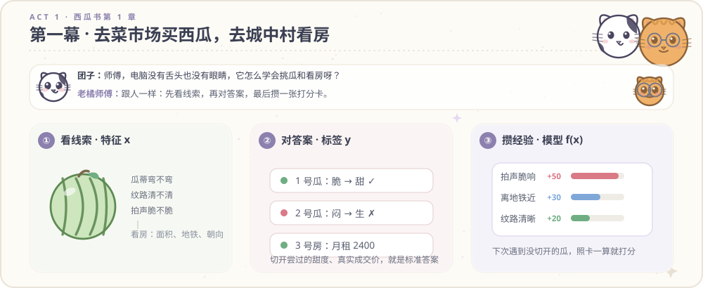

**团子**：“老橘师傅，我们挑西瓜可以用手拍一拍听声音，去租房子可以用眼睛看采光。可是电脑是一堆芯片，既没有眼睛也没有舌头，它是怎么学会猜西瓜甜不甜、猜一套房子值多少钱的？”

**老橘师傅**：“其实跟你平时去菜市场买西瓜、毕业去租房子做决定的路子一模一样。
第一步是看线索，书上叫特征（Feature，$x$）。买西瓜时你会看瓜皮花纹清不清楚、根上的瓜蒂弯不弯、拍肚皮声音脆不脆；租房子时你会看面积几平米、走到地铁站要几分钟、窗户是不是朝南。把这几条日常线索填进表格，就是喂给电脑的特征。
第二步是对答案，书上叫标签（Label，$y$）。以前买回家切开尝过的西瓜到底是甜瓜（$+1$）还是生瓜（$-1$），以前租出去的房子最后到底成交了多少钱，这些已经发生过的真实结果就叫标签。
第三步是攒经验，书上叫模型（Model，$f(x)$）。电脑翻看过去几百次买瓜、看房的旧账本，摸索出一张打分比重卡，比如离地铁近加 30 分、拍着脆响加 50 分、花纹模糊扣 20 分。以后遇到没切开的新西瓜、没标价的新房子，拿这张打分卡一算总分就能猜个八九不离十。”

---

## 第二幕：期末考试复习的三种学生（欠拟合、过拟合与双下降曲线）

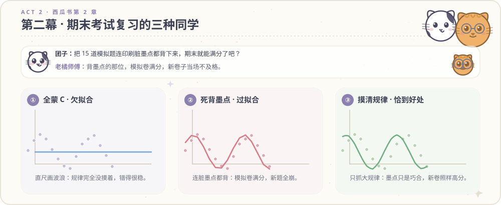

**团子**：“原来训练模型就是看旧账本攒经验。那我想到一个省事拿满分的招数：只要让电脑把过去 15 道复习模拟题的答案背得一字不差，等明天期末考新卷子的时候，它是不是就能稳拿满分了？”

**老橘师傅**：“你这一下就踩中了机器学习里最常见的坑。想想咱们学校期末考试前，班里复习的三种同学：
第一种同学偷懒连书都不翻，上考场全蒙 C，这叫欠拟合（高偏差 Bias）。不管题目问什么，他脑子里只有死板的一招，就像拿一把硬直尺去画波浪线，连最基本的出题规律都没看懂，模拟考和期末考都不及格（MATLAB 实测 $p=1$ 时测试误差高达 $0.6030$）。
第二种同学连模拟卷角落的印刷脏墨点都背下来，这叫过拟合（高方差 Variance）。他把 15 道模拟题背得滚瓜烂熟，甚至发现模拟卷第 8 题右上角蹭了一点印刷厂的脏墨点，而那道题恰好选 B，于是在笔记本上记下口诀：凡是右上角有脏墨点的题一律选 B。结果他在模拟卷上考了接近满分，第二天期末考试发下干净的新卷子，没有脏墨点了，当场考砸。
第三种同学摸清解题套路，自动忽略印刷脏墨点，这叫恰当泛化。他知道卷子上的脏墨点只是印刷厂手抖的偶然噪声（Noise），只记背后的加减乘除规律。虽然模拟卷因为那道带墨点的题没拿满分，但换任何新卷子都能稳定拿高分（$p=4$ 时测试误差降至 $0.1666$）。”

**团子**：“原来死记硬背巧合就叫过拟合。可是师傅，现在大家都在用的深度学习大模型，肚子里有几百亿个参数旋钮，比复习题的数量多几万倍，为什么大模型没有变成死背脏墨点的书呆子？”

**老橘师傅**：“这就是下面右图画出来的现代双下降曲线（Double Descent）。当你的旋钮数量刚好贴近模拟题数量（比如 15 个旋钮配 15 道题）时，为了强行穿过那个印刷脏墨点，线条只有唯一一种拧麻花的走法，考新题错得最厉害；但当旋钮多到用不完（比如 110 个旋钮配 15 道题）时，能穿过所有题目的曲线有无数条，最小范数求解会自动挑出最平缓、最不折腾的那一条顺滑曲线，考新题的误差反而迎来了第二次下降。”

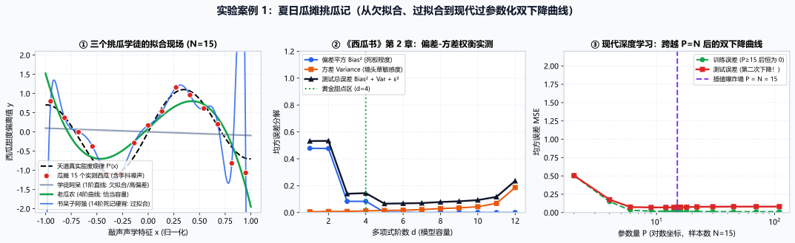

配套互动实验课：[`notebooks/01_夏日挑瓜记_偏差方差与双下降曲线.ipynb`](notebooks/01_夏日挑瓜记_偏差方差与双下降曲线.ipynb)

---

## 第三幕：首富进班拉歪平均工资与搬家小行李箱断舍离（$L_2$、$L_1$ 与 Lasso）

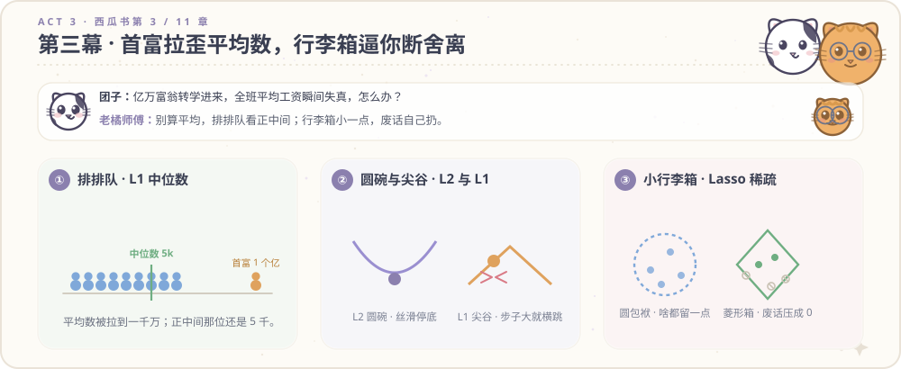

**团子**：“师傅，既然复习题里经常混进一两个印错的脏墨点或者离谱的奇葩数据，那电脑在算工资、算房价的时候，怎么才能不被这一两个极端数据带偏？”

**老橘师傅**：“咱们拿统计全班同学月薪来算一笔账。假设班里有 9 个普通打工人，月薪都在 5000 元左右（均值 $5.0$ 千元）。突然有一天，班里转来一个亿万富翁，一个月赚 1 个亿（$100000$ 千元）。这时候用两把不同的尺子（损失函数）去量班里的收入水平，结果完全不同：
第一把尺子叫平方误差（$L_2$ Loss，对应算平均数）。它看到谁和预测值不一样，就把差距自己乘自己（平方）。普通同学差 1 千块，平方是 1；首富差了 1 个亿，平方之后放大了一亿倍。为了迁就首富一个人，MATLAB 实测算出来的全班平均月薪直接飙到了 $10004.5$ 千元（即 1000.45 万元），全班 9 个普通同学全被平均了。
第二把尺子叫绝对值误差（$L_1$ Loss，对应排队看中位数）。咱们不搞平方，让全班 10 个人从穷到富排成一排，只看站在队伍正中间的那个人赚多少。无论站在队尾的首富赚 1 个亿还是 1000 个亿，站在队伍正中间第 5 号同学的中位数始终稳稳停在 $5.0$ 千元，一分钱都不会被首富带偏。”

**团子**：“排队看正中间的人确实稳。可是我在 [`线性神经网络.ipynb`](线性神经网络.ipynb) 笔记里算过，用 $L_1$ 绝对值误差往下走的时候，走到谷底老是停不稳，那是为什么？”

**老橘师傅**：“看下面这张用 MATLAB R2026a 导出的慢动作滚珠动画就清楚了：左边的 $L_2$ 平方误差像一个圆底瓷碗，越靠近碗底坡度越平缓，珠子滚到碗底就自然停住了；右边的 $L_1$ 绝对值误差像一个尖底 V 字槽，左边斜坡陡度恒为 $-1$，右边斜坡陡度恒为 $+1$。如果每一步迈出的步长固定不变，一步跨过尖底到了右边，下一步又原封不动跨回左边，就会在谷底左右反复横跳。”

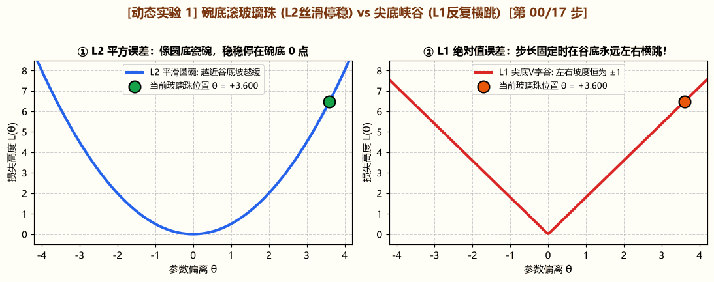

**团子**：“原来公式动起来是这个样子。那图右边画的搬家收行李箱又是什么意思？”

**老橘师傅**：“那是《西瓜书》第 11 章专门治废话太多的招数。假设中介给你 10 条租房线索，其实只有面积和离地铁距离有用，另外 8 条全是房东星座、看房黄历、货车车牌尾号这种纯废话。现在规定搬家只能带一个小号行李箱（正则化约束）：
$L_2$ 岭回归（Ridge）像个舍不得扔旧衣服的人，把 10 件衣服全缩成迷你小团塞进圆箱子，8 条废话线索全都留着小尾巴；$L_1$ 稀疏回归（Lasso）的箱子是带尖角的菱形，装东西时只留 2 件天天穿的外套，把那 8 件没用的废话衣服权重直接压成 $0$ 清出箱子。”

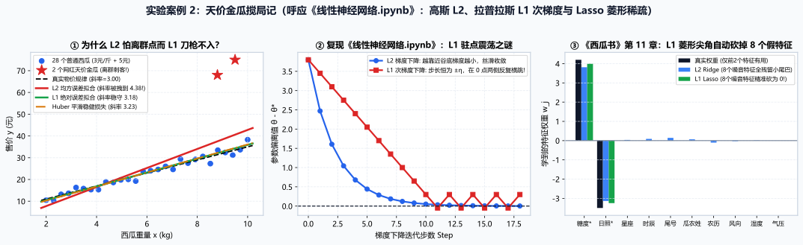

配套互动实验课：[`notebooks/02_天价金瓜搅局记_L1与L2损失及Lasso稀疏几何.ipynb`](notebooks/02_天价金瓜搅局记_L1与L2损失及Lasso稀疏几何.ipynb)

---

## 第四幕：医院分诊台问诊与老奶奶折纸剪窗花（决策树与深度神经网络）


**团子**：“师傅，前面算房价、算工资，都是面积越大越贵的一条直线。可生活里好多事根本不是直线，比如泡方便面，水温太低泡不熟，水温太高又泡烂了；再比如盘子里红花和蓝花摆成了两个互相勾着的弯月牙。这时候画直线分不开，该怎么办？”

**老橘师傅**：“遇到这种拐弯抹角的问题，传统机器学习和现代深度学习拿出了两套不同的办法：
第一招像医院分诊台护士按顺序问问题（决策树，《西瓜书》第 4 章）。去医院挂号时，护士先问第一句：体温超过 38 度了吗（相当于在坐标纸上竖着切一刀）；再问第二句：肚子疼不疼（相当于横着切一刀）。因为每次只能单看一个指标横切或竖切，遇到弯弯的月牙图案，决策树只能横一刀、竖一刀，把平面切成锯齿状的方格楼梯。
第二招像老奶奶折纸剪窗花，先把纸折好再一刀剪下（深度神经网络，《西瓜书》第 5 章）。想在彩纸上剪出对称窗花，不用拿剪刀拐十八个弯，而是先把彩纸对折、拉伸、抚平（对应神经网络的隐藏层非线性变换 $h = \tanh(Wx+b)$），让原本混在一起的红蓝月牙分列到纸的左右两侧，最后拿直剪刀直剪一刀就彻底分开了。下面这帧 MATLAB R2026a 动画展示了隐藏层把坐标纸一步步拉开的过程：”

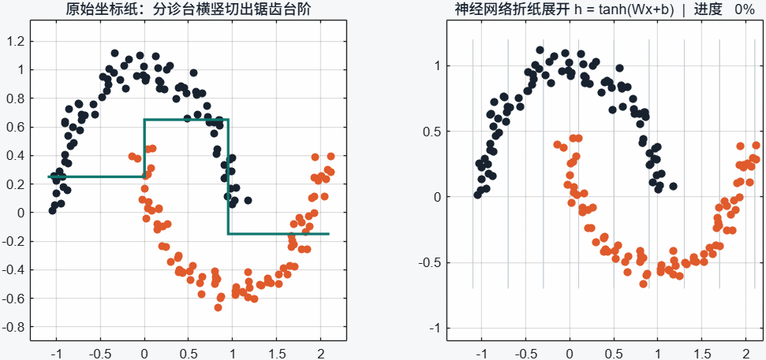

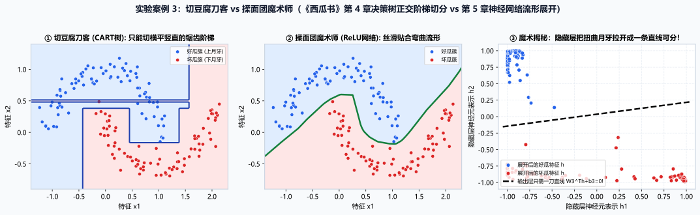

配套互动实验课：[`notebooks/03_切豆腐与揉面团_决策树与神经网络流形对决.ipynb`](notebooks/03_切豆腐与揉面团_决策树与神经网络流形对决.ipynb)

---

## 第五幕：马路中间画最宽双黄线与大厨颠铁锅筛花生米（支持向量机与核函数）

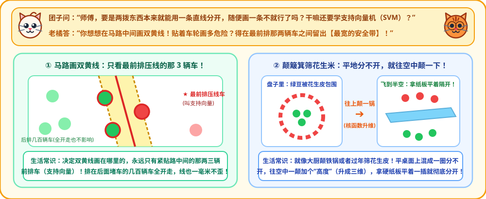

**团子**：“师傅，上一幕神经网络把红蓝图案拉到了纸的两边，随便画一条直线就能剪开。那如果两拨东西本来就能用一条直线分开，闭着眼睛随便画一条不就行了吗？干嘛还要学《西瓜书》第 6 章的支持向量机（SVM）？”

**老橘师傅**：“你想想，要是让你去大马路正中间画双黄线，你会紧贴着左边汽车的轮胎画吗？肯定不会，因为左边的车方向盘稍微抖一下就压线了。最稳妥的画法，是先找到左边最靠路中间的那两辆车，再找到右边最靠路中间的那一辆车，在它们正中间留出一条最宽的安全缓冲带（最大间隔）。
这里有个很关键的数学性质：决定马路中间双黄线画在哪里的，永远只有最前排压线的那两三辆车（支持向量 Support Vectors）。至于排在它们后面堵车的几百辆汽车，哪怕现在全部掉头开回家，马路中间的双黄线连一毫米都不会动。”

**团子**：“那要是遇到平底铁锅里，绿豆聚在锅底正中心，红色的花生皮像呼啦圈一样围在外圈，在平锅里怎么画直线都会切到两边，这又该怎么分？”

**老橘师傅**：“想想大厨是怎么颠铁锅的。在二维平底锅里确实画不出直线，但只要握住锅柄往空中猛颠一下（对应二阶多项式核函数升维 $z = x_1^2 + x_2^2$），离锅心远的外圈花生皮被颠到了半空中，聚在锅心的绿豆稳稳留在锅底。这时候拿一张硬纸板从半空中平平地横插过去，上面全是花生皮，下面全是绿豆，一刀就上下分家了。看下面这帧 MATLAB R2026a 渲染的三维升维旋转动画：”

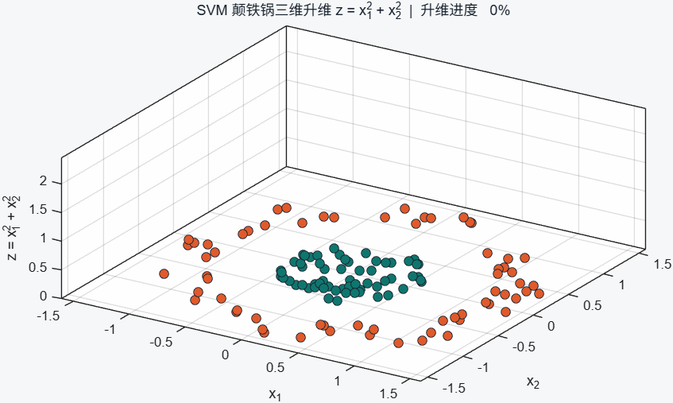

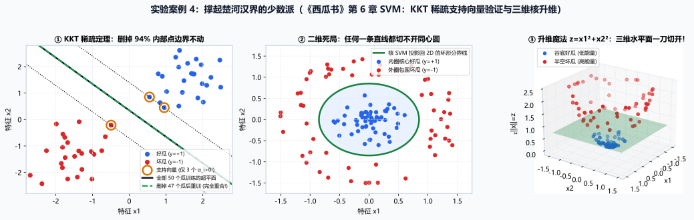

配套互动实验课：[`notebooks/04_撑起楚河汉界的少数派_SVM对偶与核技巧案例.ipynb`](notebooks/04_撑起楚河汉界的少数派_SVM对偶与核技巧案例.ipynb)

---

## 第六幕：歌手大赛评委团与木匠师徒接力打家具（随机森林与 GBDT）


**团子**：“师傅，要是遇到难猜的事，一个模型总是拿不准，我想找一群模型一起商量（《西瓜书》第 8 章的集成学习）。那我把同一个模型复印 50 份，让它们一起举手投票行不行？”

**老橘师傅**：“要是把同一个人的脑子复印 50 份，他看走眼的时候 50 个克隆人也会整齐划一地看走眼，投多少票都没用。真正管用的团队配合有两种路子：
第一种配合像歌手大赛评委团，各看各的求平均（随机森林 Bagging）。节目组会给 30 位评委分派不同的观察重点：1 号评委侧重听高音，2 号评委侧重听节拍，3 号评委侧重看舞台表现（随机特征子空间）。单个评委可能偶尔手抖打高 2 分或打低 2 分，但把 30 位不同角度评委的打分加起来求平均，各自手抖的毛刺互相抵消，合成出一条平顺的预测线（专门降低方差 Variance）。
第二种配合像木匠师徒排成流水线，后一个人专门补前一个人的差价（梯度提升树 GBDT Boosting）。做一件 100 分的木雕家具，师徒三人按顺序接力修补残差：第一棒大徒弟拿大斧头先砍出 60 分的粗毛坯，留下 $+40$ 分的粗糙坑洼（残差）；第二棒二徒弟拿木工刨，不从头砍树，只盯着那 $+40$ 分的坑洼去推平，补上 $+30$ 分，总分到了 $60+30=90$ 分，只剩 $+10$ 分的小毛刺；第三棒老师傅拿细砂纸，专门对着最后那 $+10$ 分的细小毛刺打磨，师徒三人加起来 $60+30+10=100$ 分收工（专门降低偏差 Bias）。”

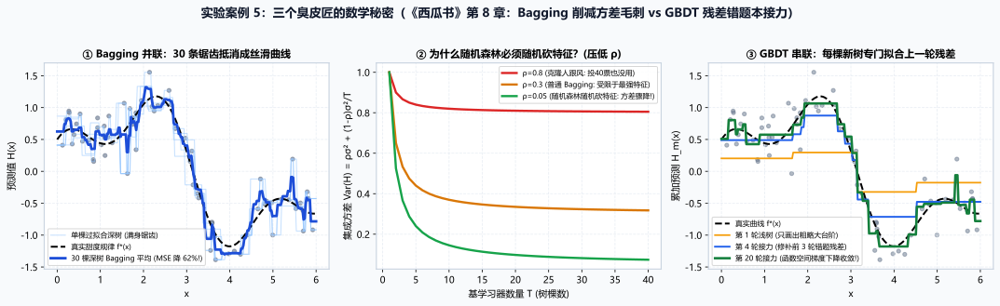

配套互动实验课：[`notebooks/05_三个臭皮匠的数学秘密_随机森林与GBDT残差接力.ipynb`](notebooks/05_三个臭皮匠的数学秘密_随机森林与GBDT残差接力.ipynb)

---

## 第七幕：开学第一天操场广播体操分队（K-Means 与 EM 算法软聚类）


**团子**：“师傅，前面讲的买西瓜、租房子、期末考，都有老师提前给好标准答案。要是开学第一天，操场上站了两个班的同学做广播体操，大家没穿校服、也没戴名牌（无监督聚类），电脑怎么自动把两个班分出来？”

**老橘师傅**：“你看操场上那两排同学，一班在北边排成了一条细长的东西向横队，二班在南边也排成了一条细长的横队。这时候有两种分班办法：
第一种是插两面旗子拿圆规画正圆圈（K-Means 算法）。K-Means 只看每个同学到旗子的直线欧氏距离（正圆球面），它在操场左边插一面红旗、右边插一面蓝旗，结果一刀从两列横队的腰中间竖着劈下去，把上下两列细长的广播体操队拦腰切成了左右两半（MATLAB 实测准确率只有 $54.7\%$，跟抛硬币差不多）。
第二种是先猜人、再顺着队形拉长橡皮筋（EM 算法与高斯混合模型 GMM）。分两步来回迭代：第一步（E 步）先拿两条橡皮筋在操场上套一下，算出每个同学有几成把握属于一班、几成把握属于二班；第二步（M 步）顺着一班同学横排的队形，把橡皮筋拉长、压扁成贴合队形的细长椭圆（更新协方差矩阵 $\Sigma_k$）。下面这帧 MATLAB R2026a 实测的 14 轮迭代动画里，左图两条橡皮筋一步步拉长贴合南北横队，右图的对数似然下界（ELBO）从 $-3.270$ 单调爬升到 $-2.407$，最终分班准确率达到 $98.8\%$。”

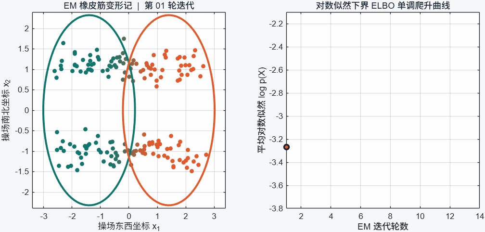

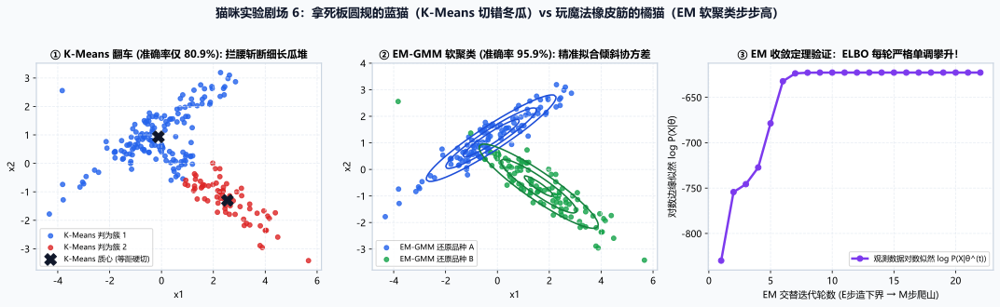

---

## 第八幕：大饭店 100 道工序把汤做咸了，怎么倒查 1 趟抓出撒盐师傅？（反向传播与自动求导）


**团子**：“师傅，我已经明白电脑是怎么猜东西、怎么折纸、怎么组队、怎么分群了。但我还有最后一个问题：现在的深度学习模型里有几百亿个调味旋钮（参数 $w$），当它算错一道题的时候，怎么在一眨眼之间算出这几百亿个旋钮每个该往左拧还是往右拧？”

**老橘师傅**：“这就是整本手稿收尾的核心算法：反向传播（Backpropagation，简称 BP）。
想象一家有 100 道工序的大饭店后厨：1 号切菜配菜，2 号腌肉撒盐，3 号看火炖汤，一路传到 100 号装盘端上桌。结果今天这碗汤端上桌，店长尝了一口发现太咸了。怎么最快抓出是谁手抖放多了盐？
如果用笨办法（有限差分试错），让 1 号厨师重做一锅尝尝，再让 2 号厨师重做一锅尝尝，100 个厨师就得重做 100 锅汤；要是模型有 100 亿个旋钮，就得重算 100 亿次前向传播。
如果用反向传播（对应 `backward()`），规定每个厨师把菜往下传的时候，都在传菜签（计算图）上记一笔局部导数。等店长尝出太咸之后，拿着传菜签从最后一道装盘工往回倒查 1 趟（链式法则）：100 号只管装盘没放盐，3 号只管看火没放盐，查到 2 号调味师傅，传菜签上记着他每勺盐把咸度放大了 2 倍，当场就能算出他的改错梯度。不管后厨有一百道还是一百亿道工序，往前做 1 趟菜（前向传播）加顺着传菜签往回查 1 趟（反向传播），所有旋钮的梯度一次全部算完。”

在第 6 册互动实验课 [`notebooks/06_盲人摸象的搭桥术_EM聚类与手搓自动求导引擎.ipynb`](notebooks/06_盲人摸象的搭桥术_EM聚类与手搓自动求导引擎.ipynb) 中，我们用 35 行纯 Python 代码手写了一个完整的标量自动求导引擎 `Value` 类，并与 PyTorch 的 `.backward()` 逐位核对了梯度结果。

---

## 仓库目录结构与复现说明

```text
notes-for-deep-learniung/
├── index.html                                                     # Hallmark Studio 印前校样交互版（通过 sloplint 0 FAIL 0 WARN 校验）
├── style.css / tokens.css / base.css                              # Hallmark Studio 材质与排版样式系统
├── README.md                                                      # 团子与老橘师傅的生活故事绘本主读本
├── notebooks/                                                     # 6 册师徒对话交互式 Jupyter 实验课（含完整运行输出）
│   ├── 01_夏日挑瓜记_偏差方差与双下降曲线.ipynb
│   ├── 02_天价金瓜搅局记_L1与L2损失及Lasso稀疏几何.ipynb
│   ├── 03_切豆腐与揉面团_决策树与神经网络流形对决.ipynb
│   ├── 04_撑起楚河汉界的少数派_SVM对偶与核技巧案例.ipynb
│   ├── 05_三个臭皮匠的数学秘密_随机森林与GBDT残差接力.ipynb
│   └── 06_盲人摸象的搭桥术_EM聚类与手搓自动求导引擎.ipynb
├── assets/                                                        # 8 张师徒对话插图 (pic01~08.svg) + 4 张 MATLAB R2026a 动态图 (anim01~04.gif) + 6 张实验对比图
├── experiments/                                                   # 科学仿真与图表生成脚本
│   ├── matlab_animations.m                                        # 原生 MATLAB R2026a 动态 GIF 与实测数据生成脚本
│   ├── matlab_r2026a_metrics.json                                 # MATLAB R2026a (26.1.0.3203278) 实测导出的基准数据
│   ├── build_cartoon_svgs.py                                      # 生成 8 张团子问与老橘答场景 SVG
│   ├── build_storybook_cases.py                                   # 生成 6 张实验对比 SVG
│   └── build_cat_notebooks.py                                     # 组装并预执行 6 册 Jupyter Notebook
└── 数据处理笔记.ipynb / 自动求导笔记.ipynb / 线性回归的实现.ipynb / ... # 早期手写 PyTorch 基础与数学推导笔记
```
